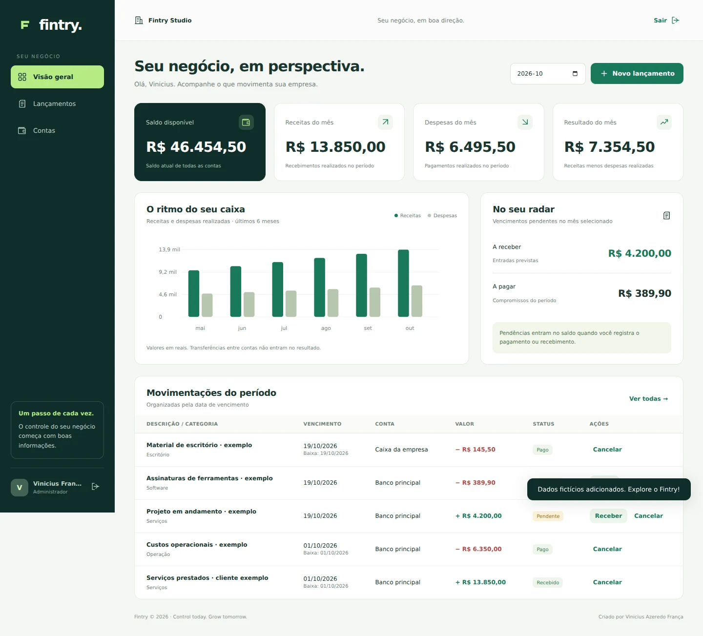

# Fintry

**Control today. Grow tomorrow.**

**Versão atual: 0.20.0**

Novo cadastro abre a comparação de planos, com Profissional em teste de 14 dias no modo comercial e opção de começar sem contratar. Veja [primeiro acesso](docs/01-product/first-access.md).

Mensalidades do próprio Fintry por Pix/boleto, preços configuráveis, fatura hospedada e ativação/renovação por recebimento confirmado. Cada emissão concede 30 dias. O Administrador pode autorizar a geração recorrente das próximas faturas; Pix/boleto continuam exigindo pagamento, sem débito automático. Veja [recorrência e operação](docs/05-api/subscription-renewals.md). Consulte [configuração das mensalidades](docs/05-api/subscription-payments.md).

Planos Essencial, Profissional e Gestão com capacidade por empresa, teste de 14 dias, solicitações e atendimento comercial. Consulte [planos e operação comercial](docs/05-api/subscriptions.md).

Cobranças integradas Asaas com Pix/boleto, Sandbox, consulta e webhook. Veja [configuração e limites de cobrança](docs/05-api/billing.md). · [Changelog](docs/01-product/changelog.md) · [Roadmap](docs/01-product/roadmap.md)

Gestão financeira para pequenas empresas, desenvolvida por **Vinicius Azeredo França**. O Fintry organiza contas, receitas, despesas e o fluxo de caixa em uma interface em português.



## Publicação e operação

A 0.14.0 acrescenta uma configuração de produção separada, com HTTPS pelo Caddy, SMTP autenticado com TLS, diagnóstico **Ambiente** para Administrador e rotinas de backup/restauração PostgreSQL. O Docker local continua funcionando pelos comandos abaixo.

- [Publicar no servidor](docs/07-devops/deployment.md): domínio/HTTPS, configuração, atualização e recuperação.
- [Backups e restauração](docs/07-devops/backups.md): arquivo com SHA-256, teste isolado e exemplos de timers.
- [Monitoramento](docs/07-devops/monitoring.md): prontidão, logs e teste de e-mail para o próprio acesso.

A configuração está pronta para ser preenchida e validada; a integração no GitHub não cria hospedagem nem publica um domínio. Para colocar online, ainda são necessários servidor, domínio, SMTP e armazenamento externo de cópias.

## OFX e conciliação bancária

Em **Conciliação**, escolha uma conta, importe um extrato OFX e confira banco, final da conta e movimentos na prévia. Adicionar à revisão não cria lançamentos nem altera o saldo. Depois, decida por movimento:

- **Buscar correspondência:** vincule a um realizado com a mesma data sem alterar o saldo, ou a um pendente para registrar a baixa na data do banco. Valor, tipo e conta devem coincidir.
- **Criar lançamento:** confira as correspondências, escolha uma categoria e confirme a criação como realizado. Havendo outro lançamento de mesmo valor/tipo, é preciso justificar que se trata de um movimento distinto.
- **Ignorar:** registre um motivo; o movimento continua consultável.
- **Reabrir revisão:** remove a decisão/vínculo, preservando o pagamento. Correções financeiras são feitas pelas ações existentes depois da reabertura.

Administradores e Financeiro podem importar e decidir; Consulta pode acompanhar as revisões. A tela oferece um OFX fictício para contas de avaliação. Use até 1 MB/500 movimentos por arquivo, de uma conta bancária em BRL, em UTF-8 ou Windows-1252. Cartões, investimentos, correções OFX e conciliação de valores parciais/agrupados ficam fora desta versão. A integração é por arquivo; não há conexão automática com bancos. [Detalhes e API](docs/05-api/bank-reconciliation.md).

## Rodar com Docker (recomendado)

Pré-requisito: Docker Desktop com Docker Compose. No Windows, abra o terminal na pasta do projeto com o Docker Desktop iniciado.

```bash
git clone https://github.com/FrancaCODEX/fintry-finance.git
cd fintry-finance
git switch main
git pull --ff-only
docker compose up --build -d
```

Abra **http://localhost:8080**, clique em **Criar conta** e preencha seu nome, empresa, CNPJ com 14 dígitos, e-mail e uma senha com pelo menos 10 caracteres. Para uma avaliação, use dados fictícios.

Abra **Dados de exemplo** no menu (ou **Explorar com dados de exemplo** no primeiro acesso) e confirme **Adicionar exemplos**. O pacote opcional preenche contas, contatos, categorias, seis meses de financeiro, séries, produtos/estoque, vendas, orçamentos e comprovantes fictícios. Pode ser adicionado uma vez por empresa, inclusive se já houver cadastros: preserva seus registros e não duplica ao repetir. Os valores entram nos indicadores da empresa; use uma empresa de avaliação para explorar sem misturar com dados reais. Não é carregado automaticamente.

O primeiro build baixa as dependências Java. Para acompanhar a inicialização:

```bash
docker compose logs -f app
```

Para parar, preservando os dados:

```bash
docker compose down
```

Os dados do PostgreSQL ficam no volume `fintry-data`. Não use `docker compose down -v` se quiser preservá-los. Para mudar a porta, copie `.env.example` para `.env` e ajuste `APP_PORT` (por exemplo, `8081`). Se já houver um banco criado por uma versão anterior do projeto, este Compose usa seu próprio volume; os dados anteriores não são importados automaticamente.

## Serviços e propostas

Cadastre **Serviços** com código, preço e custo de referência; eles não possuem estoque. Em **Propostas**, escolha produtos/serviços, cliente, validade e preços, salve o rascunho e baixe o PDF. Coloque a proposta **em negociação** e use **Aprovar e gerar venda** para escolher conta, vencimento e recebimento. A aprovação cria a venda confirmada e a receita na mesma transação; somente produtos baixam estoque. A equipe registra a negociação no Fintry; nenhum e-mail é enviado automaticamente. Veja as [regras comerciais](docs/05-api/proposals-and-services.md).

## Importar lançamentos CSV

Em **Importar CSV**, baixe o modelo e escolha uma conta de destino. Envie um CSV UTF-8 (até 1 MB e 500 registros), revise os erros/possíveis duplicidades, selecione os registros prontos e confirme. A prévia não salva dados. São aceitas receitas/despesas pendentes e realizadas; realizados exigem a data de pagamento. Nomes de categorias existentes são vinculados; novas categorias ficam avulsas. Reenvios e registros com a mesma conta, descrição, tipo, valor e vencimento são ignorados por possível duplicidade. Veja o [formato e as regras de importação](docs/05-api/csv-imports.md).

## Rodar sem Docker

Pré-requisito: **JDK 21**. O Maven Wrapper já acompanha o projeto.

Linux / WSL / macOS:

```bash
cd backend
sh mvnw spring-boot:run -Dspring-boot.run.profiles=demo
```

Windows / PowerShell:

```powershell
cd backend
.\mvnw.cmd spring-boot:run "-Dspring-boot.run.profiles=demo"
```

Abra **http://localhost:8080**. O perfil `demo` usa H2 persistido em `./data/` relativo à pasta de execução (`backend/data/` nos comandos acima), sem precisar instalar PostgreSQL. H2 é uma alternativa para avaliação local; PostgreSQL é o banco principal. Os dois ambientes têm bancos separados. Não há credencial padrão: crie seu próprio acesso.

## Interface e navegação (0.10.0)

O menu está organizado em Financeiro, Comercial, Cadastros e Seu espaço. No desktop, use **Recolher menu** para trabalhar com uma lateral compacta; a preferência fica salva neste navegador. A busca **Buscar no menu** filtra as páginas por nome, incluindo termos sem acentos. O atalho **/** leva à busca quando você não está preenchendo um campo nem em um formulário modal.

Em telas de até 900 px, **Abrir menu** mostra um painel com as mesmas páginas e permissões. Feche com Escape, pelo botão ou tocando fora; selecionar uma página fecha o painel. O foco permanece no painel enquanto ele está aberto.

O cabeçalho fixo mostra a seção e a página atual. A rolagem do menu é preservada entre consultas e mantém a página ativa visível; mudar de página retorna o conteúdo ao topo. Barras de rolagem usam as cores do tema, inclusive nas listas, formulários e comprovantes. Em páginas longas, **Voltar ao topo** retorna ao título. A interface respeita movimento reduzido e oferece **Ir para o conteúdo** para navegação por teclado.

A camada visual `design.css` mantém a identidade verde com espaçamentos, superfícies, tabelas, botões e campos consistentes em claro/escuro e celular. Nenhuma regra financeira ou estrutura de dados mudou nesta versão.

## Orçamento por categoria (0.9.0)

Em **Orçamentos**, selecione o mês e defina limites para categorias cadastradas de despesa ou mistas. O acompanhamento usa o vencimento no mês: **pago + pendente** compõem o valor comprometido. Atenção a partir de 80%, excedido acima de 100%; valores acima do limite não bloqueiam lançamentos nem reservam saldo. Transferências e cancelados ficam fora.

Os indicadores incluem somente categorias com limite definido. O bloco **Despesas sem orçamento** mostra separadamente categorias sem limite e lançamentos com categoria avulsa. Renomear ou inativar uma categoria preserva seu acompanhamento pelo vínculo; para criar novos limites, escolha categorias ativas.

Copie limites do mês anterior sem duplicar categorias existentes no destino nem copiar lançamentos. Remover um orçamento preserva despesas e histórico. Administrador/Financeiro gerenciam; Somente leitura consulta. A tela oferece cartões responsivos e suporte a claro/escuro.

## Central de pendências e uso diário (0.8.0)

Em **Pendências**, acompanhe lançamentos ainda não realizados de todas as datas, incluindo receitas de vendas, parcelas e recorrências. Os grupos usam a data atual do servidor no horário de Brasília: **Vencidas**, **Vencem hoje**, **Próximos 7 dias** (amanhã até o sétimo dia) e **De 8 a 30 dias**. **Todas as pendências** também inclui datas posteriores a 30 dias.

Filtre por descrição, tipo, conta e origem (sem série, recorrências ou parcelamentos). Os indicadores respeitam esses filtros e mostram todos os grupos; o grupo selecionado restringe a lista e seus totais. Totais incluem todas as páginas, sem tratar valores pendentes como saldo realizado. Realizados, cancelados e transferências ficam fora da central.

Use Detalhes, Pagar/Receber ou as ações permitidas para o lançamento. A confirmação continua exigindo a data da baixa; não há pagamento automático ou baixa em lote. Receitas de vendas continuam protegidas contra cancelamento isolado. O perfil Somente leitura consulta sem ações de escrita.

O dashboard mostra os primeiros cinco vencimentos entre hoje e os próximos sete dias e um atalho para atrasos. Esse bloco usa datas atuais, independentemente do mês selecionado nos indicadores financeiros acima. Na central, consulte todos os resultados.

Lançamentos passam a usar cartões no celular, com valores, datas, conta, situação e ações visíveis. No desktop, a tabela permite rolagem com cabeçalho fixo. Carregamentos mostram skeletons e erros de consulta oferecem nova tentativa. Os formulários apresentam erros junto aos campos, preservam as descrições acessíveis e levam o foco ao primeiro erro; botões indicam processamento para evitar submissões repetidas. As mesmas melhorias se aplicam aos temas claro e escuro.

## Produtos, estoque e vendas (0.7.0)

Em **Produtos**, cadastre SKU/código único, nome, unidade, preço, custo de referência, estoque inicial e estoque mínimo. O catálogo mostra disponibilidade e alerta para saldo igual ou abaixo do mínimo; oferece busca, filtros, inativação e histórico. A unidade é fixa após cadastrar; para outro tipo de unidade, crie outro produto. Quantidades aceitam até três casas decimais.

Em **Estoque**, consulte entradas, saídas e saldo após cada movimento. Movimentações manuais pedem quantidade e motivo; não é permitido saldo negativo. O estoque inicial, as vendas confirmadas e suas devoluções também aparecem no histórico. Ajustes de estoque não criam despesas: registre compras e pagamentos em Lançamentos. O indicador de valor usa a quantidade dos produtos ativos multiplicada pelo custo atual cadastrado, sem cálculo de custo médio/contabilidade fiscal.

Em **Vendas**, crie um rascunho com cliente opcional e até 100 produtos. Confira quantidades, preços e total antes de salvar. Nomes, códigos, unidades e preços são preservados nos itens; rascunhos não reservam estoque. Para corrigir itens de um rascunho, cancele e crie outro.

Ao **confirmar**, escolha conta, vencimento e se a venda já foi recebida. O Fintry confere o estoque novamente, registra as saídas e cria uma única receita vinculada. Se qualquer etapa falhar, toda a confirmação é revertida. Sem recebimento imediato, a receita fica pendente e a baixa pode ser feita no financeiro. Repetir a confirmação mantém o registro original, sem outra receita ou saída.

Ao **cancelar uma venda confirmada**, os itens voltam ao estoque e a receita é cancelada na mesma transação. Se já estava recebida, deixa de compor o saldo. A operação registra o estorno no controle financeiro; não executa devolução bancária. Para proteger a consistência, o lançamento vinculado não pode ser editado/cancelado isoladamente. Comprovantes continuam disponíveis no painel de detalhes.

Administrador e Financeiro gerenciam esses recursos; Somente leitura pode consultar. O histórico de alterações inclui catálogo, movimentações e vendas. Esta etapa é um controle interno: não inclui NF-e, cobrança bancária, reservas, descontos, devoluções parciais ou integração automática de compras.

## Equipe e segurança (0.6.0)

Em **Equipe**, um Administrador pode convidar pessoas e definir o perfil. **Administrador** gerencia toda a empresa, equipe e histórico; **Financeiro** gerencia finanças e comprovantes; **Somente leitura** consulta e exporta informações. Todo perfil pode alterar a própria senha em **Minha segurança**. Mudanças de acesso ou senha encerram as sessões existentes. O administrador original mantém seu acesso após a atualização.

O convite gera um link de ativação válido por **7 dias**, exibido uma única vez para copiar e compartilhar diretamente com a pessoa. A pessoa confere empresa, e-mail e perfil, define sua senha e entra normalmente. Gerar outro convite invalida o anterior; revogá-lo impede a ativação. Contas inativas podem receber outro convite. Desativar um usuário preserva seus registros.

Em **Histórico**, o Administrador consulta autor, horário e campos alterados, com busca, filtros por área/período (até 366 dias) e paginação. Os registros começam na 0.6.0; versões anteriores não são reconstruídas. Senhas, tokens e conteúdo de arquivos não entram no histórico.

### Recuperação de senha e e-mail local

Com Docker, o serviço **Mailpit** captura os e-mails de teste. Abra **http://localhost:8025**, use **Esqueci minha senha** no Fintry e abra o link recebido. Essa caixa é de avaliação local e não entrega mensagens para a internet. As portas 8025/1025 ficam ligadas somente ao localhost.

O link de recuperação vale **15 minutos**, funciona uma única vez e encerra sessões anteriores depois da troca. A resposta é igual para e-mails cadastrados e desconhecidos. Convites são compartilhados manualmente e não dependem de SMTP.

Para outra porta/endereço do Fintry, ajuste `APP_BASE_URL` em `.env` (por exemplo `http://localhost:8081`). Em acesso por outro computador, use o endereço acessível ao destinatário. Os links usam essa configuração, nunca o cabeçalho Host da requisição.

Para SMTP real, configure `SMTP_HOST`, `SMTP_PORT`, `SMTP_USERNAME`, `SMTP_PASSWORD`, `SMTP_AUTH`, `SMTP_STARTTLS`, `MAIL_FROM`, `APP_BASE_URL` e `MAIL_ENABLED=true`. Fora do Docker a recuperação fica desabilitada por padrão; a interface informa quando não está disponível. As variáveis precisam ser exportadas no processo Java: `.env` é lido automaticamente apenas pelo Compose. Veja [segurança](docs/03-architecture/security.md).

## O que já funciona

- Cadastro de empresa e administrador; login e logout com sessão HTTP.
- Recuperação de senha, convites, equipe com três perfis, troca de senha e histórico de alterações.
- Catálogo de produtos, estoque mínimo, movimentações e vendas integradas às receitas.
- Central de pendências com indicadores por vencimento, filtros, totais completos e ações rápidas.
- Isolamento dos dados por empresa, derivado da sessão autenticada.
- Contas financeiras com saldo inicial e saldo calculado.
- Receitas e despesas com valor, categoria, conta e vencimento.
- Parcelamentos mensais e recorrências de valor fixo, com 2 a 120 ocorrências.
- Prévia de datas/valores, acompanhamento e cancelamento de pendências de séries.
- Lançamentos pendentes e realizados; baixa com data de pagamento.
- Edição de lançamentos pendentes, sem alterar saldos realizados.
- Cancelamento preservando o histórico; para corrigir um registro realizado, cancele e cadastre novamente.
- Clientes e fornecedores com busca, paginação, edição e inativação/reativação.
- Categorias de receitas/despesas com cadastro, edição e inativação.
- Vínculo opcional de lançamentos a clientes/fornecedores e categorias cadastradas.
- Transferência atômica entre duas contas da mesma empresa.
- Busca, filtro por tipo/status, período mensal e paginação de lançamentos.
- Dashboard com saldo atual, resultado de caixa, comparação com o mês anterior, despesas por categoria e gráfico de seis meses.
- Relatórios por período, conta, tipo, situação, categoria e cliente/fornecedor.
- Exportações CSV, Excel (.xlsx) e PDF com os filtros aplicados.
- Fluxo de caixa projetado por dia, com horizonte e conta selecionáveis e indicação de saldo negativo.
- Painel lateral com detalhes e ações de lançamento, sem sair da lista.
- Comprovantes PDF, PNG e JPEG: envio, download e remoção, isolados por empresa.
- Modo claro/escuro, alternância salva no navegador e preferência inicial do sistema.
- Bordas e foco dos campos reforçados nos dois temas.
- Layout responsivo e dados de exemplo opcionais.
- Migrações Flyway e testes de integração HTTP.

**Como os números são calculados:** saldo inicial + receitas realizadas − despesas realizadas. Pendências usam o vencimento; indicadores realizados usam a data de pagamento. O saldo disponível é o saldo atual de todas as contas, independentemente do mês selecionado. Transferências afetam cada conta, mas não entram nas receitas/despesas e no resultado. Valores são armazenados com `BigDecimal` e duas casas decimais. A baixa repetida do mesmo lançamento não duplica o movimento.

## Stack e estrutura

Java 21 · Spring Boot 4.1 · Spring Security · JPA/Hibernate · PostgreSQL · Flyway · Docker.

A interface inicial usa HTML, CSS e JavaScript servidos pelo próprio Spring Boot. Assim, o primeiro uso exige apenas uma aplicação, sem instalação de Node ou processo separado para o frontend. React/TypeScript permanecem como uma possibilidade de evolução, não como funcionalidade implementada.

```text
backend/src/main/java/com/fintry/
  auth/       # cadastro, sessão e empresa autenticada
  company/    # dados da própria empresa
  finance/    # contas, lançamentos, transferências e indicadores
  directory/  # clientes, fornecedores e categorias financeiras
  report/     # relatórios, exportações e projeção de caixa
  attachment/ # comprovantes validados e vinculados aos lançamentos
  shared/     # configuração, entidades base e erros
backend/src/main/resources/
  static/           # interface
  db/migration/     # PostgreSQL; mantém V1 e V2 existentes
  db/demo/          # schema equivalente para H2
```

## Testes

```bash
cd backend
sh mvnw verify
```

Por padrão, os testes usam H2. Para repetir a suíte contra um PostgreSQL local dedicado, crie `fintry_test` (usuário `fintry`, senha `fintry-test`) e execute:

```bash
sh mvnw -Dspring.profiles.active=postgres-test verify
```

A CI executa ambos com JDK 21 e também constrói a imagem Docker. A suíte cobre autenticação, CSRF, isolamento entre empresas, valores inválidos, datas, filtros, baixa repetida, cancelamento, transferências, séries mensais, relatórios, projeções e arquivos exportados.

## Próximas entregas

A sequência está no [roadmap](docs/01-product/roadmap.md):

- **Entregue até 0.10.0:** controle financeiro, relatórios/projeções, comprovantes, acesso/equipe, produtos/estoque/vendas, central de pendências, orçamentos, exemplos completos e navegação/visual renovados.
- **Próximas prioridades:** importação CSV com prévia e detecção de duplicidades e evolução de serviços/propostas, conforme o roadmap.

Depois da base: importações/conciliação, integrações bancárias, cobrança, planos/assinaturas, recorrências sem prazo final e organização avançada dos comprovantes.

Esta é uma versão funcional para desenvolvimento e demonstração. A recuperação de senha já está implementada e requer a configuração de e-mail. Antes de oferecer o serviço a clientes, é necessário definir e testar backups, observabilidade e a operação em produção. Para publicar, configure HTTPS, `COOKIE_SECURE=true`, credenciais próprias e a infraestrutura de acesso; o Compose padrão expõe a aplicação apenas no computador local. Sessões são armazenadas no processo e expiram em 30 minutos de inatividade; reiniciar a aplicação exige novo login.

Contato: **vfranca.dev@gmail.com**

## Atualizar da primeira versão

Na pasta do projeto:

```bash
git fetch origin
git switch main
git pull --ff-only
git pull --ff-only origin codex/fintry-v0.5-comprovantes-temas
docker compose up --build -d
```

A atualização adiciona tabelas e vínculos por migração Flyway; não precisa recriar o banco nem remover o volume. Os lançamentos antigos mantêm a categoria em texto e podem continuar sendo usados. Não execute `docker compose down -v` para atualizar.

Os novos menus são **Clientes e fornecedores** e **Categorias**. Cadastre os registros e selecione-os no formulário de lançamento. Um contato pode ser cliente, fornecedor ou ambos. Receitas aceitam clientes; despesas aceitam fornecedores. Categorias podem ser de receitas, despesas ou ambas.

Inativar um cadastro preserva os lançamentos existentes. Um vínculo antigo inativo pode ser mantido ao editar sua pendência; novos vínculos exigem cadastros ativos. Nomes de contato/categoria ficam registrados no lançamento no momento em que ele é salvo, preservando o histórico em caso de renomeação. O tipo de um cadastro vinculado não pode ser alterado. CPF/CNPJ de contatos são opcionais; a validação nesta versão verifica formato e quantidade de dígitos, não consulta situação cadastral.

## Parcelamentos e recorrências — v0.3.0

No formulário **Novo lançamento**, escolha o formato:

- **Lançamento único:** mantém o fluxo existente.
- **Parcelar um valor total:** informe o total e a quantidade. R$ 100,00 em 3 parcelas gera R$ 33,34 + R$ 33,33 + R$ 33,33. Os centavos excedentes ficam nas primeiras parcelas.
- **Repetir valor mensalmente:** informe o valor de cada mês e a quantidade. R$ 250,00 por 4 repetições gera quatro lançamentos de R$ 250,00. Não há renovação automática nesta versão.

Confira a prévia antes de registrar. Vencimento em 31 de janeiro resulta em 28/29 de fevereiro e 31 de março. A opção de pagamento inicial vale somente para a primeira ocorrência; as demais ficam pendentes. As baixas continuam individuais em **Lançamentos**, selecionando o mês do vencimento.

O menu **Parcelas e recorrências** mostra o progresso e todos os vencimentos. **Cancelar pendências** cancela todas as ocorrências pendentes da série, inclusive vencidas, preservando as realizadas. Não há edição individual de ocorrências de série; para ajustar, cancele as pendências e crie uma nova série. Lançamentos únicos pendentes continuam editáveis.

A atualização é incremental e preserva contas, contatos, categorias e lançamentos. O JAR passa a ter nome estável: `backend/target/fintry.jar`. Para executar o pacote sem Docker: `java -jar backend/target/fintry.jar --spring.profiles.active=demo`.

## Relatórios e fluxo projetado — v0.4.0

No menu **Relatórios**, aplique um período de até 366 dias. A base **pagamento / recebimento** considera somente realizados pela data da baixa; **vencimento** permite consultar realizados, pendentes ou cancelados. Totais e despesas por categoria consideram todos os registros filtrados, independentemente da página. Transferências ficam fora do relatório; cancelados podem ser consultados, mas não compõem os totais.

Os botões **CSV**, **Excel** e **PDF** exportam até 5.000 registros com os filtros já aplicados. CSV contém os lançamentos; Excel e PDF também trazem empresa, período, filtros e totais. Valores do Excel são numéricos e textos não viram fórmulas. No PDF, textos longos são abreviados e caracteres fora da fonte ocidental são substituídos; CSV e Excel preservam o texto completo.

Em **Fluxo projetado**, escolha a conta e um horizonte de até 366 dias. O saldo atual é o ponto de partida; pendências entram pela data do vencimento, incluindo parcelas e recorrências já cadastradas. A projeção inclui hoje e o último dia do horizonte. Pendências vencidas são exibidas à parte e ficam excluídas por padrão; a opção de incluí-las as considera previstas para hoje. A tela mostra saldo final, menor saldo e primeira data com saldo negativo, usando os valores líquidos de cada dia. Nenhuma consulta ou exportação registra baixas ou altera o saldo realizado.

A 0.4.0 não modifica o schema do banco. Atualize a aplicação preservando seus dados e volumes.

## Comprovantes, detalhes e temas — v0.5.0

Clique em **Detalhes** na lista ou no dashboard; nos relatórios, clique na descrição do lançamento. O painel lateral mostra conta, categoria, contato, situação, datas, parcela/repetição e as ações permitidas para aquele registro. É possível editar pendências únicas, registrar baixa ou cancelar sem perder a posição na página. Feche pelo botão ou pela tecla Escape.

Em **Comprovantes**, envie um arquivo PDF, PNG ou JPEG por vez: até **5 MB por arquivo**, **10 arquivos por lançamento** e **20 megapixels por imagem**. O servidor verifica o conteúdo, não apenas o nome ou o tipo informado pelo navegador. PDFs protegidos por senha e arquivos corrompidos são recusados. A lista registra nome, tamanho, data e usuário que anexou. Baixar preserva os bytes originais; remover exige confirmação e exclui o arquivo, preservando o lançamento. Baixar ou anexar não muda o saldo. A baixa e o cancelamento preservam os comprovantes; anexos de uma parcela pertencem somente àquela ocorrência.

Os arquivos ficam no próprio banco de dados, junto dos metadados, sem diretório público de uploads nem volume adicional. O backup do banco deve incluir a nova tabela `entry_attachments`, pois ela contém também os arquivos. Na avaliação H2, eles permanecem no banco local em `./data/`, relativo à pasta de execução; no Compose, no volume PostgreSQL existente. O limite de 5 MB usa 5 × 1024 × 1024 bytes. O envio aceita uma requisição de até 6 MB, incluindo o envelope multipart.

O botão **Escuro / Claro** aparece no acesso, no topo da aplicação e no painel de detalhes. Sem escolha salva, o tema acompanha o sistema. Após alternar, a escolha é mantida naquele navegador, inclusive após recarregar ou sair da conta. Limpar a preferência `fintry-theme` no navegador restaura o acompanhamento do sistema. O tema é aplicado antes da folha de estilos; campos têm bordas mais visíveis, fundos próprios e indicação de foco em ambos os modos.

Migrações incrementais: PostgreSQL V6 e H2 V4. Atualize sem recriar o banco nem remover volumes.

## Política de versões

Toda entrega deve atualizar a versão em `backend/pom.xml`, o número acima e o changelog. Funcionalidades/melhorias incrementam MINOR (ex.: 0.3.0 → 0.4.0); correções isoladas incrementam PATCH (ex.: 0.3.0 → 0.3.1). A interface lê a versão do backend, sem manter um segundo número fixo. A CI executa `python3 scripts/check_release.py` para verificar a consistência.
